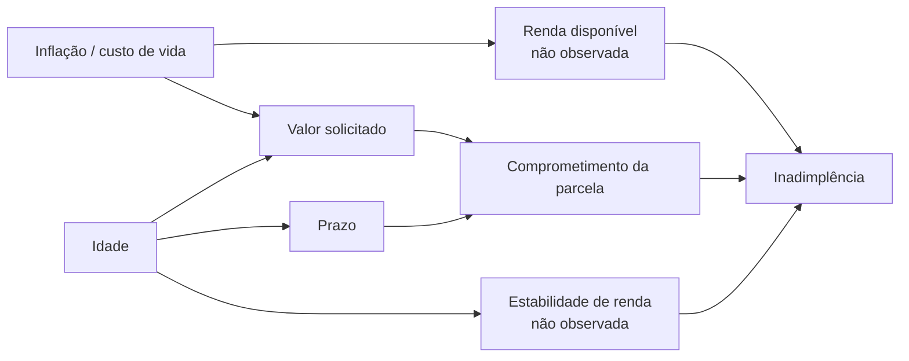

# Análise causal

O modelo prevê **associação**, não causa. Este documento explicita as hipóteses causais usadas na simulação, mostra o que os experimentos do projeto sustentam e aponta o que eles não provam.

## 1. Grafo causal assumido (DAG)

Como ler:

- **Inflação** eleva o valor que as pessoas pedem e, ao mesmo tempo, reduz a renda disponível para pagar. É um *confundidor* da relação valor → inadimplência.
- **Valor e prazo** determinam o comprometimento da parcela, que atua sobre a inadimplência.
- **Idade** influencia o que se pede (valor e prazo) e a estabilidade de renda.
- **Renda e estabilidade de renda não existem no dataset.** O modelo só enxerga os sinais indiretos (valor, prazo, idade, patrimônio, emprego).

## 2. Como a simulação traduz o DAG

O dataset não tem inflação nem desemprego. Duas simplificações:

- **Inflação** foi simulada como um multiplicador sobre `valor_credito` (×1,10, ×1,25, ×1,40). É o efeito inflação → valor, sem a variável inflação.
- **Concept drift** foi imposto por construção: em t2 e t3, parte dos bons pagadores com valor acima da mediana **e** prazo acima de 24 meses passa a ser mau pagador (25% em t2, 60% em t3). Isso representa a hipótese de que, com a renda real comprimida, parcelas altas e longas passam a ser inadimplidas.

Logo, o efeito causal "parcela alta e longa → inadimplência" foi **inserido por nós** no gerador de dados. Os experimentos mostram se o monitoramento o detecta, não se a relação existe no mundo real.

## 3. Drift nas features não implica mudança causal

Distinguir os dois tipos de mudança:

| | O que muda | Exemplo no projeto | Efeito esperado no modelo |
|---|---|---|---|
| **Data drift** (covariate shift) | A distribuição das entradas P(X) | Valores e prazos maiores, clientes mais jovens ou mais velhos | Nenhum, se a relação P(Y\|X) se mantém |
| **Concept drift** | A relação entre entradas e alvo P(Y\|X) | Parcelas altas e longas passam a ser mais inadimplidas | Degradação |

### Evidência dos experimentos

Ablação em `python -m src.simulation.ablation` (20 seeds por cenário, AUC no lote):

| Lote | Só data drift | Data + concept drift |
|---|---|---|
| teste base (sem drift) | 0,760 | — |
| t1 | 0,760 | 0,760 |
| t2 | 0,760 | 0,736 (± 0,013) |
| t3 | 0,758 (± 0,002) | 0,707 (± 0,021) |

- No t3, o PSI de `duracao_credito` chega a **5,0** (drift enorme), mas **só o data drift quase não afeta a AUC** (0,760 → 0,758).
- A queda de AUC aparece quando o **concept drift** é adicionado (0,707).
- **Consequência prática:** alertas baseados só em PSI geram falsos positivos (o modelo continua bom) e **não enxergam** o concept drift. Para detectá-lo é preciso monitorar o desempenho com rótulos, que chegam com atraso em crédito.

### Por que o data drift sozinho foi inofensivo aqui

A AUC mede apenas a ordenação dos clientes por risco. Deslocar valor, prazo e idade em bloco, preservando a relação com o alvo, pouco altera essa ordenação. Em outro modelo ou outra mudança de população (por exemplo, quando o novo público cai numa região do espaço onde o modelo nunca viu dados), o data drift **pode** degradar. O resultado vale para esta simulação.

## 4. Limitações

1. **Associação, não causa.** Os coeficientes da Regressão Logística dizem como as variáveis se associam à inadimplência no treino. Não permitem afirmar que reduzir o prazo de um cliente reduz a chance de inadimplência dele (confundimento, variáveis não observadas, seleção: só se observa a inadimplência de quem teve crédito aprovado).
2. **Viés de seleção.** O dataset contém apenas clientes aprovados no passado; o modelo nunca viu os negados.
3. **Concept drift sintético.** A magnitude (25% e 60%) foi escolhida por nós, sem base empírica.
4. **Lotes não independentes.** Os três lotes usam as mesmas 300 linhas do teste base, com transformações diferentes.
5. **Amostra pequena** (1.000 linhas no total), abaixo dos 5.000 que o enunciado pede.
6. **Sem variáveis macroeconômicas reais.** Inflação e desemprego do DAG não foram medidos.

